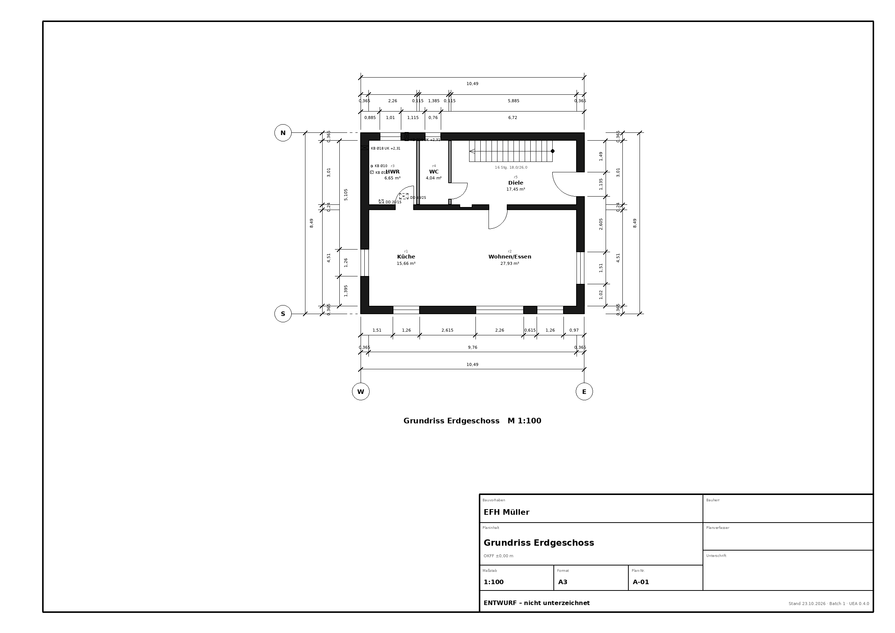
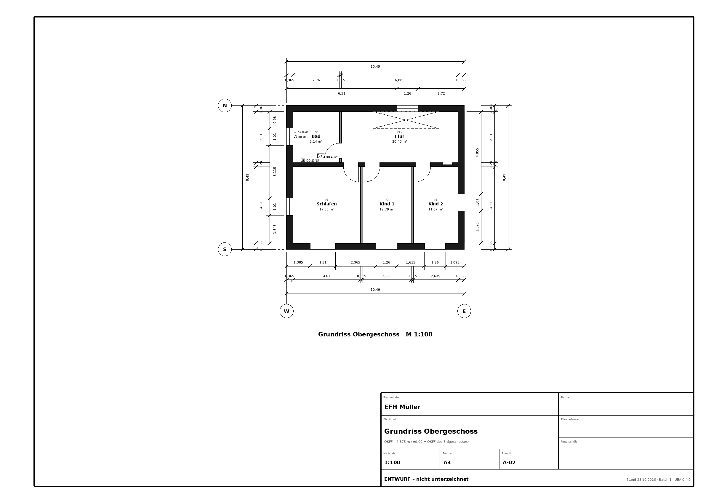

# Prototype: Haus Müller

A normal Einfamilienhaus, written by hand in the draft format before any code exists, to test the format and to settle the open datum questions. It is the first candidate for the token task set (`bench/`).

Status: draft, 2026-10-07. Since 2026-10-09 `project`, `arch`, `light` and `elec` load in UEA, since 2026-10-10 `heat` too, since 2026-10-11 `plumb` and `vent` (the `illum` targets wait for the lighting design), and the holes the services asked for. The syntax will change. Types, cables, protective devices and products are illustrative placeholders, not design data. No Fachplaner has checked the design.

## The house

Two full storeys and a cold Spitzboden under a 25° Satteldach. Masonry, 36,5 cm Ziegel outside, 10,49 × 8,49 m in Oktameter. Heated by an air-to-water heat pump with Fußbodenheizung, ventilated by a central unit with heat recovery in the HWR (until 2026-10-11 by two pairs of decentral units, which fell short).

| Room | Finished m² | | Room | Finished m² |
|---|---|---|---|---|
| r1 Küche | 15.66 | | r6 Schlafen | 17.83 |
| r2 Wohnen/Essen | 27.93 | | r7 Kind 1 | 12.79 |
| r3 HWR | 6.65 | | r8 Kind 2 | 11.67 |
| r4 WC | 4.04 | | r9 Bad | 8.14 |
| r5 Diele (with stair) | 17.45 | | r10 Flur (with stair hole) | 20.43 |
| **EG** | **71.72** | | **OG** | **70.85** |

Floor areas between finished wall surfaces. Not the Wohnfläche: WoFlV deductions (stair, hole) are a calculator's job.

Electrical: SLS, SPD, 5 RCDs, 19 circuits, 30 socket boxes (45 outlets), 18 switches, 20 luminaires, 3 data outlets, 5 Rauchwarnmelder, feeds for the heat pump, the indoor unit and the ventilation unit.

## Exports

Drawings are SVG with a PNG copy; labels are German, because German offices read them.

**Drawn by UEA.** The services sheets and the Positionspläne come from UEA itself: `uea export svg <name>` and `uea export png <name>` on a copy of these files without the two `illum` lines (their pack is not built yet). The PDF of the same sheet is `uea export pdf <name>`. Pipe and duct sizes are in the calculation reports, not on the plans. Holes (`docs/decisions/0039-openings-without-a-fill.md`) show on every floor plan: KB a core drilling, DD a hole through a slab, dashed when it is in the slab above.

| Export | Name | Content |
|---|---|---|
| [Heizung EG](exports/heizung-EG.png), [OG](exports/heizung-OG.png) | `heat:EG`, `heat:OG` | Heat pump, indoor unit, manifolds in their niches, FBH zones per room with their outputs, the towel radiator, the derived flow and return pipes through ho4 |
| [Heizungsschema](exports/heizungsschema.png) | `heat:schema` | Heizungs- und Trinkwasserschema: heat pump, indoor unit with the tank, both manifolds with their loops per room (`docs/decisions/0036-heating-and-plumbing-sheets.md`) |
| [Sanitär EG](exports/sanitaer-EG.png), [OG](exports/sanitaer-OG.png) | `plumb:EG`, `plumb:OG` | Water meter, riser and stack, fixtures, the derived drinking-water and waste pipes, the sewer connection |
| [Strangschema](exports/strangschema.png) | `plumb:schema` | The riser diagram: meter, tank, riser, the fixtures per storey, the stack vented over the roof, the sewer |
| [Lüftung EG](exports/lueftung-EG.png), [OG](exports/lueftung-OG.png) | `vent:EG`, `vent:OG` | The central unit lg1 in the HWR, outdoor and exhaust air through the core drillings ho1 and ho2, supply and extract terminals, the derived ducts up through ho3 |
| [Positionsplan EG](exports/positionsplan-EG.png), [OG](exports/positionsplan-OG.png), [DB](exports/positionsplan-DB.png) | `struct:EG`, `struct:OG`, `struct:DB` | The positions of the Statische Berechnung (`docs/decisions/0040-structure.md`): load-bearing walls in blue with their numbers, the lintels over their openings in red, the slab over the storey, the roof and its eaves on the Spitzboden, and the strip footings beside the EG's walls (3.02 · 4.01) |

**Not UEA exports.** The other files are generated from the `.uea` files by a throwaway script outside the repository; they show what the model must be able to deliver.

| Export | Content |
|---|---|
| [Grundrisse](exports/grundriss-EG.png) | EG and OG with every element of every discipline |
| [Ansichten](exports/ansichten.png) | North, east, south and west elevations, with heights from the roof geometry (ridge +8.10, eaves +6.12) |
| [Elektro EG](exports/elektro-EG.png), [OG](exports/elektro-OG.png) | Installationspläne with simplified DIN EN 60617 symbols, circuits and switching lines. Aus-, Serien-, Wechsel- and Kreuzschaltung are derived from how many switches control each luminaire |
| [Verteilungsplan](exports/verteilung-b1.png) | Single-line diagram of b1 and its Belegung (6 rows of 12 TE). The phase assignment is derived |
| [Lichtberechnung r2](exports/lichtberechnung-r2.md) | A `custom` calculation, not norm-compliant: point-by-point direct light plus an indirect estimate, two variants against the targets in `light.uea` |

## Files

| File | Lines | Characters |
|---|---|---|
| `project.uea` | 8 | 213 |
| `arch.uea` | 78 | 3,570 |
| `light.uea` | 25 | 844 |
| `elec.uea` | 86 | 2,979 |
| `heat.uea` | 21 | 842 |
| `plumb.uea` | 14 | 612 |
| `vent.uea` | 14 | 572 |
| `issues.uea` | 10 | 901 |
| **Total** | **256** | **10,533** |

`session.md` shows how an agent builds this through the CLI: batches, placeholders, a request, an upstream change that breaks the electrical design, a revert, a calculation that leads to a design change, and the services' requests for holes answered by the architect.

### Tokens

Counted with `tools/prototype/count_tokens.py` and `tiktoken` (`o200k_base`), on the files as they were on 2026-10-07 (the counts above are current; the tokens were not recounted, because this environment cannot download tiktoken's encoding). That is OpenAI's tokenizer, so the absolute numbers are an approximation for Claude; the ratios are what matter.

| Format, same 226 elements | Tokens | Per element | vs. line format |
|---|---|---|---|
| Line format (all `.uea` files) | 4,471 | 19.8 | 1.00× |
| JSON, minified | 7,627 | 33.7 | 1.71× |
| YAML | 9,045 | 40.0 | 2.02× |
| JSON, indented | 12,273 | 54.3 | 2.75× |

The whole house costs about 4,500 tokens to read. The JSON and YAML versions keep the same compact values (`y=w1+4.51` stays a string), so the table measures the syntax alone. A format with coordinates instead of intent would cost more. The operation lines shown in `session.md` take 1,454 tokens; all of its CLI blocks, commands and output, take 3,179.

## Conventions

Decided in `docs/decisions/0012-datums-and-positions.md`; this prototype is the worked example.

### Datums

- **Plan positions are core faces** (Rohbau): the faces of a type's core layer, marked `*` in its layers. Finished sizes are derived from the other layers.
- **Heights count from the storey's FFL** (OKFF). A level's `z` is its FFL (±0.00 = FFL of the ground storey). `fb` is the floor build-up, so the SSL (OK Rohdecke) = `z − fb`.
- **Openings** have structural sizes `W x H` (Rohbaurichtmaße). Windows hang from the storey's head height (`level EG ... head=2.26`), so their sill is derived; `sill=` is written only for a window that deviates. Doors stand on OKFF.
- **Devices:** `z` is the box centre above the FFL. A device's position along its wall is its centre; an opening's position is its edge, as in a dimension chain (Maßkette).

### Positions

| Expression | Meaning |
|---|---|
| `x=w4+2.26` | My −x side is 2.26 beyond w4's +x face; I extend in +x. A clear dimension, as in a dimension chain |
| `x=E-` | My +x side is on grid E; I extend in −x |
| `y=w5.n-` | Explicit face: my +y side on w5's north face |
| `x=d4+0.25` | 0.25 past the + edge of opening d4 |
| `y=f2.c` | On the centre of window f2 |
| `y=w1..w3` | Span between the faces of w1 and w3 that face each other |
| `on=w1` | Same footprint as w1 (a wall stacked on another) |
| `at=w4+1,w1+1` | A point (room seeds, ceiling lights, equipment on the floor) |
| host `w5.s` | The south face of w5. An exterior wall without a face means its inside face |

Everything resolves relative to something else. Make the HWR wider by moving w6, and w7, d2, d4, the board, the switches next to the doors and the WC washbasin follow.

### Names, ids, placeholders

- The agent names levels, grids and types (`EG`, `W`, `AW-365`). UEA assigns the ids of all other elements.
- Names and ids start with a letter. German numeric axes get a letter name and a drawing label (`grid A1 x=0 label=1`).
- Grid and level names contain no `-`: in a position, `W-1.2` means grid W minus 1.2 m.
- Placeholders in a batch are `@name`, not `$name`: a shell expands `$name` when an agent forgets to quote its heredoc. `_` adds an element that nothing in the batch refers to.

| Pack | Kinds and id prefixes |
|---|---|
| arch | `wall` w, `door` d, `win` f, `niche` ni, `slab` sl, `void` v, `roof` rf, `stair` st, `sep` rs, `room` r |
| light | `lum` l |
| elec | `board` b, `rcd` fi, `circ` c, `sock` s, `conn` a, `switch` sw, `data` dt, `smoke` rm, `feed` fd |
| heat | `gen` g, `tank` t, `man` hv, `ufh` uh, `rad` hk |
| plumb | `san` sa, `meter` wz, `riser` sr, `stack` fl, `sewer` kn |
| vent | `fan` vl |
| issues | `req` q, `waive` wv |

### Defaults

`sock` and `data` at z=0.30, `switch` at 1.05. Ceiling luminaires and smoke alarms at the room centre unless `at=` says otherwise. Windows and doors use the type marked `default`. A slab's outline comes from the walls below it, a stair hole from `over=`.

### Derived, not stored

Whether a wall is exterior, wall joins, room outlines (from the seed point), stair run and riser height (st1: 16 risers of 18.0 cm, tread 26 cm, 2h+a = 61.9 cm), Wechsel- and Kreuzschaltung (from how many switches control one luminaire), the number of FBH circuits per room, cable routes along the installation zones, the plumbing pipes (cold, hot and waste water), and the second half of each fan pair.

### Switching

`ctl=l2,l3` is a Serienschalter with one rocker per luminaire. `ctl=l15+l16` switches both together. Several switches on one luminaire make a Wechsel- or Kreuzschaltung, and they must share a circuit.

## What the exercise showed

1. A masonry EFH needs only four grids for its outline. Everything else is placed like a dimension chain: a clear dimension from a wall face.
2. The sign in every position (`+` or `−`) is what makes it unambiguous: it says from which face and in which direction.
3. Name fields and position fields must stay apart. That is why names contain no `-`.
4. `on=` was needed for every wall stacked on the one below (5 of 17 walls).
5. Interior walls need a face when they host a device (`w6.w`); exterior walls do not.
6. The review script found its first validator rules: unknown references, a device inside or within 10 cm of an opening, back-to-back boxes in an 11,5 cm wall, and a switch on the hinge side of a door that opens into its room. The model passes all of them.
7. Six requests came up naturally (two niches, a Durchbruch, core drillings, door handing, Betoneinbaugehäuse for downlights). A request can name several targets (q4).
8. Every export asked for something the model lacked, and each gap was one small field: the terrain height (`ground=`) for the Ansichten; SLS, SPD and meters on the board for the Verteilungsplan; `src=` links for the Heizungsschema; luminaire types with flux and distribution, plus targets (`illum`), for the Lichtberechnung.
9. Drawing the door swings in the electrical plan showed five doors hinged on the side of their light switch. The check became a validator rule. The warning belongs to Elektro, which placed the switches; it asked Architektur to turn the doors (q5), and Architektur did.
10. The Lichtberechnung ran the loop the architecture intends: code calculated, variant A missed the target, the agent added four dimmed downlights, code calculated again. The downlights then needed a request to Architektur (q6), because the ceiling is concrete.
11. The Heizungsschema derives 9 FBH loops for the EG manifold; UEA derives 8 with the placeholder type FBH-15 (`docs/decisions/0034-heating-elements.md`), 10 outlets each. Whether the manifold fits the 0,60 m niche that heat asked for in q1 needs manufacturer data; the type carries its width (`w=`). With the synthetic tables of the tests, `uea calc heatload` finds the WC and the bath short of underfloor heating: a towel radiator is the designer's next step.
12. The plumbing needed four elements besides the fixtures: the meter, a riser, the stack that q3 asked for, and the sewer connection outside. UEA derives the pipes between them: 26 m cold, 21 m hot from the indoor unit, 21 m of waste pipe, all seven fixtures on the one stack. The cold tree runs past the washing machine to the riser, a shortest tree, not a planner's route; risers and `to=` are how an agent steers it.
13. The heating pipes needed three values from the manufacturer: the copper pipe system (`hpipe`), the loop pipe of the underfloor type and the heat pump's loss. UEA derives 3.9 m from the heat pump to the indoor unit and 12.7 m on to both manifolds. With synthetic tables, `uea calc hydronic` makes the bath's loop the index circuit at hv2 and gives every other loop its valve setting.
14. The ventilation first had two pairs of decentral units. With synthetic tables, `uea calc airflow` found that infiltration alone covers moisture protection, but the two pairs gave 60 of the 164 m³/h of the nominal level, and kitchen, HWR, WC and bath had no extract. Following the calculator, the design changed to a central unit (KWL) in the HWR: supply in Wohnen/Essen and the three bedrooms, extract in Küche, HWR, WC and Bad, outdoor and exhaust air on two facades. Every room now gets its flow at the nominal level, and `uea calc ducts` sizes the ducts from Ø80 to Ø160 at 28 Pa of the unit's 150. The core drillings (q4) moved to the HWR's walls, and the ducts to the OG need a slab penetration (q7).
15. With the central unit the services' checks asked for six holes: the core drillings for outdoor and exhaust air, and slab penetrations for the stack, the riser, the heating pipes to hv2 and the ducts to the OG (`docs/decisions/0039-openings-without-a-fill.md`). Two more requests (q8, q9) went to the architect, who answered all five open ones with holes ho1 to ho6 in one batch. The tank and the unit name the hole they go through (`via=`), and their pipes and ducts follow it. Only q6 stays open.
16. For the end-to-end agent test (`bench/agent/haus-mueller-services.md`) the reference had to meet its calculations. With that test's synthetic tables `uea calc heatload` found the Bad 15 W short, as finding 11 had foreseen; a towel radiator of 300 W on hv2 covers it, and `heatload`, `hydronic`, `airflow` and `ducts` are all met.

## Not in the prototype

- Structure: lintels, ring beams, load paths. It needs its own design session with a Tragwerksplaner.
- Routes along shafts. Cable routes, the plumbing, the heating pipes and the ducts are derived as shortest trees (`docs/decisions/0035-plumbing.md`, `0037-heating-pipes-and-strangschema.md`, `0038-ventilation.md`).
- Furniture and the kitchen layout; devices are placed directly.
- Attic access, railings, Außenanlagen, Schnitte. Window sash divisions, Sockel, gutters.
- Results: Wohnfläche per WoFlV, Heizlast, cable sizing and voltage drop. The lighting calculation is a `custom` prototype.

## Decided after the prototype

- Datums, the position grammar, window heads from the storey's head height, the roof's `knee` (then `kn`) as a construction value, and names for numeric axes: `docs/decisions/0012-datums-and-positions.md`.
- `into=` and `hand=` are enough to draw every door swing.
- A check that involves two disciplines belongs to the downstream one, which asks upstream with a request (`ARCHITECTURE.md` §7).
